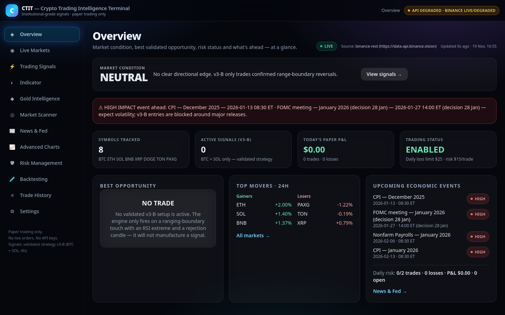
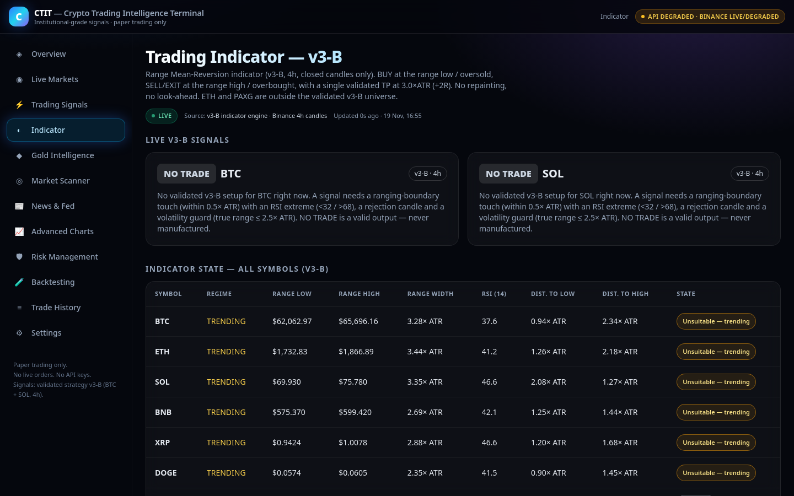
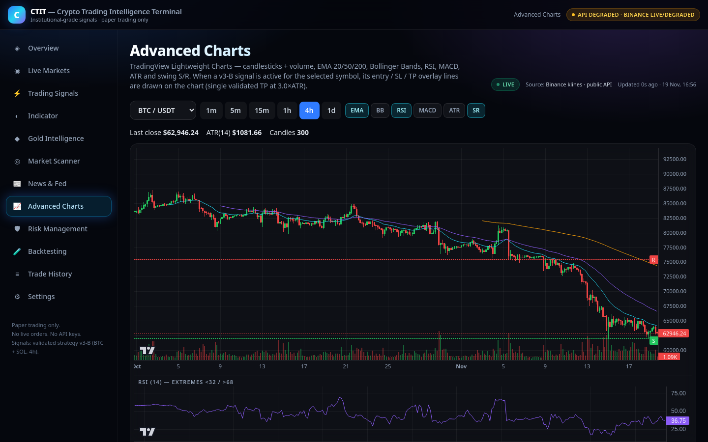
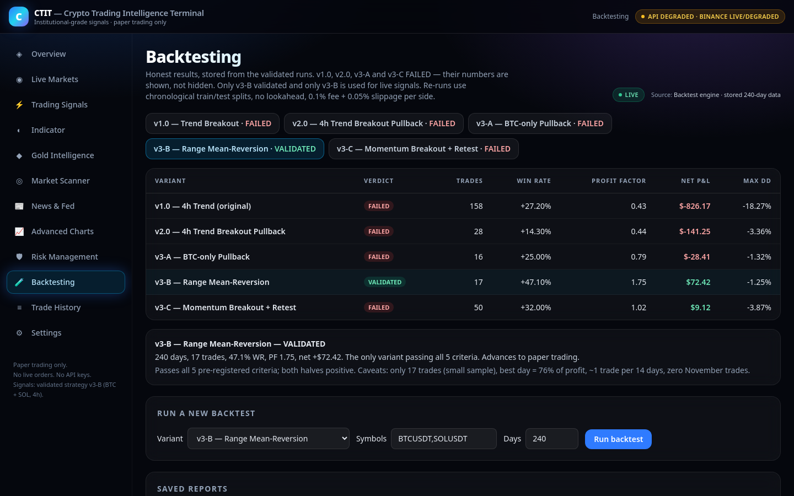
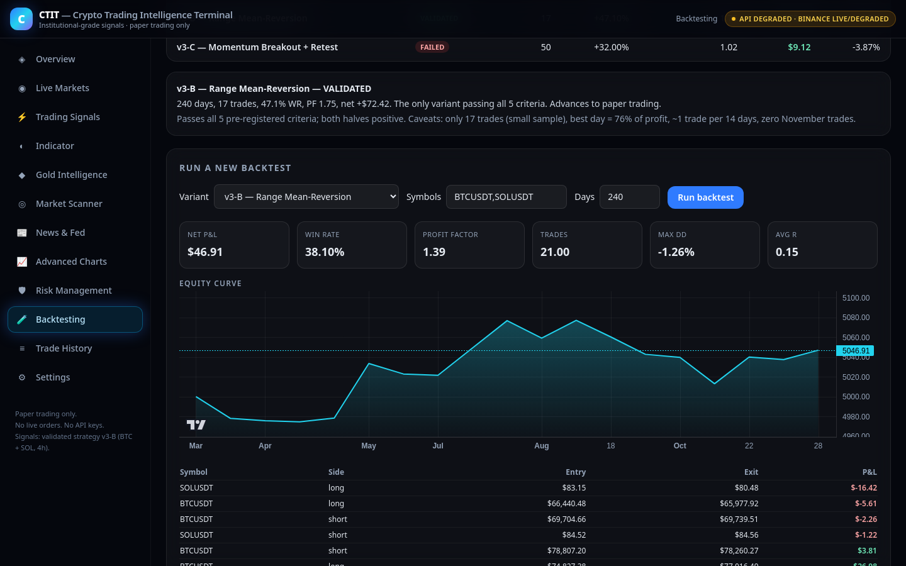
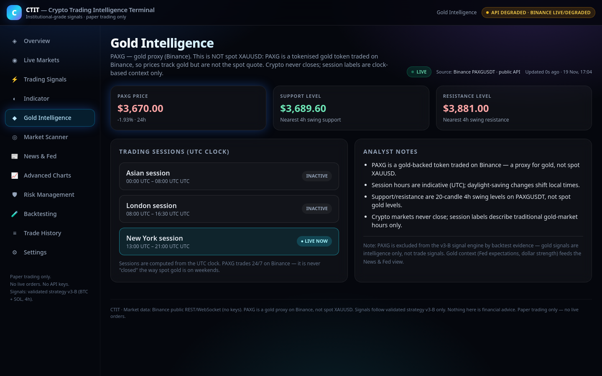

# Crypto Trading Intelligence Terminal

A premium, dark, institutional-style trading intelligence terminal for crypto
(and PAXG as a gold proxy) — built on **Binance public market data only**.
It provides live market overview, a signal engine, backtesting, paper
trading, and risk management.

**Paper trading only. No live trading, no orders, no withdrawals, no API
keys.** There is no execution path in this codebase.

## Honest status (read this first)

| Item | Status |
|---|---|
| Strategy v3-B "Range Mean-Reversion" | ✅ **Validated on backtest** — 240 days, 17 trades, 47.1% win rate, profit factor 1.75, net +$72.42. See [docs/backtesting.md](docs/backtesting.md). |
| Strategy v1.0 / v2.0 / v3-A / v3-C | ❌ **FAILED** — do not trade them. Their results are documented honestly in [docs/backtesting.md](docs/backtesting.md). |
| Paper trading (v3-B, forward, unseen data) | 🔄 **In progress** — started 19 Nov 2026. Total $+0.00, 0 trades so far. |
| Live trading | ⛔ **Not enabled and not planned until paper trading passes its GO criteria.** See [docs/risk.md](docs/risk.md). |

**Caveats on the v3-B validation (do not skip these):** only 17 trades in
240 days (a small sample); the best day (23 May 2026, +$55.19) carries 76%
of the net profit — though the result survives removing it (+$17.24 without
the best day); the H2 win rate (41.7%) passes the 40% bar by one trade; the
worst day (−$26.57) passes the −$30 line by $3.43; the strategy trades
~once per 14 days; and it took **zero trades in November 2026**. That is
exactly why forward paper trading — not live capital — is the next step.

## Features by section

The terminal has 11 sections (sidebar navigation):

1. **Overview** — market condition, best opportunity, top gainers/losers,
   upcoming Fed/economic events, active signals, daily risk status at a glance.
2. **Live Markets** — prices, 24h change, volume, funding rates and open
   interest for BTCUSDT, ETHUSDT, SOLUSDT, BNBUSDT, XRPUSDT, DOGEUSDT,
   TONUSDT, PAXGUSDT. Every section shows its source and last-updated time.
3. **Trading Signals** — v3-B signals for **BTCUSDT and SOLUSDT only**
   (the only validated symbols). ETH and PAXG are excluded by the strategy
   and the UI says so. NO TRADE is a valid output — signals are never
   manufactured.
4. **Gold Intelligence** — `PAXGUSDT`, labelled **"PAXG — gold proxy
   (Binance)"**. It is NOT spot XAUUSD; the UI says so. Includes session
   breakdown (Asian / London / New York, computed from the UTC clock),
   support/resistance and notes.
5. **Market Scanner** — RSI(14), ATR(14), SMA20/50, regime
   (RANGING / TRENDING_UP / TRENDING_DOWN), range width in ATRs, volume
   spikes, and setup status per symbol.
6. **News & Fed** — Fed/economic events from a curated schedule (official
   sources only: federalreserve.gov, BLS, BEA) and crypto news from public
   RSS (CoinDesk / CoinTelegraph). Values are `null` unless the source
   provides them — never invented.
7. **Advanced Charts** — TradingView Lightweight Charts: candles + volume,
   EMA 20/50/200, RSI, MACD, Bollinger Bands, ATR, support/resistance, and
   entry/SL/TP overlays.
8. **Risk Management** — live daily risk status, position-size calculator,
   pre-trade checklist, daily halt state. See [docs/risk.md](docs/risk.md).
9. **Backtesting** — run and compare variants v1.0, v2.0, v3-A/B/C with
   honest results, and download reports (CSV/JSON). See
   [docs/backtesting.md](docs/backtesting.md).
10. **Trade History** — paper trades from SQLite (append-only log).
11. **Settings** — daily loss limit, risk per trade, symbols, refresh
    interval.

## Architecture

```
┌─────────────────────────────────────────────────────────────────┐
│  Browser (React 18 + TypeScript + Vite + Tailwind 3)            │
│  client/  →  http://localhost:5173  (Vite proxies /api + /ws)   │
└──────────────────────────────┬──────────────────────────────────┘
                               │ HTTP + WebSocket
┌──────────────────────────────▼──────────────────────────────────┐
│  Server (Node 20 + Express + TypeScript + SQLite)               │
│  server/  →  http://localhost:3001                              │
│                                                                 │
│  ┌────────────┐  ┌──────────────┐  ┌─────────────────────────┐  │
│  │ TA (ta/)   │  │ Engines      │  │ Data sources (public)   │  │
│  │ SMA/RSI/   │  │ signal v3-B  │  │ REST data-api.binance   │  │
│  │ ATR/swings │  │ risk engine  │  │ .vision (fallback       │  │
│  │ volume SMA │  │ backtest     │  │ api.binance.us)         │  │
│  └────────────┘  │ paper trade  │  │ WS stream.binance.com   │  │
│                  └──────────────┘  └─────────────────────────┘  │
│  SQLite: server/data/terminal.db (paper_trades, signals,        │
│  settings, backtest_reports)                                    │
└─────────────────────────────────────────────────────────────────┘
```

Full contract: [ARCHITECTURE.md](ARCHITECTURE.md).
API reference: [docs/api.md](docs/api.md).
Strategy rules: [docs/strategy.md](docs/strategy.md).
Risk rules: [docs/risk.md](docs/risk.md).
Deployment: [docs/deployment.md](docs/deployment.md).

## Quickstart

### Prerequisites

- **Node.js 20+** and npm. Check with `node --version` (must be ≥ 20).
- No API keys, no accounts, no sign-in. Market data is Binance public
  data only.

### Run in development

```bash
# from the repo root
npm install --prefix server
npm install --prefix client

# start both (server on :3001, client on :5173)
npm run dev
```

Or start each package separately:

```bash
npm run dev:server   # cd server && npm run dev  (tsx watch, :3001)
npm run dev:client   # cd client && npm run dev  (Vite, :5173)
```

Open **http://localhost:5173**. The Vite dev server proxies `/api` and
`/ws` to `localhost:3001`, so the frontend never talks to Binance
directly.

### Production build

```bash
npm run build   # builds server, then client
npm start       # node server: serves the API and client/dist on :3001
```

## Screenshots

Captured 19 Nov 2026 from the actual running app (headless Chromium,
1440×900, live Binance data). See `docs/verification.md` for the full
verification report.


*Overview — NEUTRAL market condition, honest NO TRADE, live top movers, Fed warnings.*


*Trading Indicator v3-B — NO TRADE signal cards and the per-symbol indicator state table.*


*Advanced Charts — real BTC/USDT 4h candles with EMA, volume and RSI.*


*Backtesting — v1.0, v2.0, v3-A and v3-C FAILED; only v3-B VALIDATED (17 trades, 47.1% WR, PF 1.75, +$72.42).*


*Live 240-day v3-B re-run over fresh Binance data: 21 trades, +$46.91 (see `docs/verification.md` §6 for why this differs from the stored validated result).*


*Gold Intelligence — PAXG (gold proxy) $3,670.00, support $3,689.60, resistance $3,881.00, New York session live.*

## Configuration

Copy `.env.example` to `.env` and adjust. No secrets are needed — there
are no API keys in this project.

| Variable | Default | Meaning |
|---|---|---|
| `PORT` | `3001` | Server port. |
| `CLIENT_PORT` | `5173` | Vite dev-server port. |
| `BINANCE_REST_BASE` | `https://data-api.binance.vision` | Binance public REST endpoint (official public-data endpoint; `api.binance.com` is geo-blocked on some networks). |
| `BINANCE_WS_URL` | `wss://stream.binance.com:9443` | Binance public WebSocket endpoint. |
| `DB_PATH` | `./server/data/terminal.db` | SQLite database file (created on first run). |
| `PAPER_RISK_PER_TRADE` | `15` | Paper-trade risk per trade, USD. |
| `PAPER_DAILY_LOSS_LIMIT` | `25` | Paper daily loss limit, USD (configurable 20–30). |

Settings stored in the database are seeded with `dailyLossLimit=25`,
`riskPerTrade=15`. See [docs/deployment.md](docs/deployment.md) for
production notes.

## Testing

```bash
npm test                    # server tests (vitest) — risk engine, TA, backtest replay
npm --prefix server test    # same, from the server package
```

The server test suite includes the risk-engine unit tests (37 checks in
the reference implementation) and a backtest replay test: feeding the
stored 240-day data through the paper-trading harness must reproduce the
v3-B backtest exactly (17 entries, 17 exits, 8 wins, net +$72.41 vs
+$72.42 — the $0.01 is per-trade rounding to cents).

## Deployment

See [docs/deployment.md](docs/deployment.md): production build (server
serves `client/dist`), Docker (`node:20` image, no secrets),
VPS + nginx reverse-proxy example, environment variables, health checks,
and troubleshooting (Binance geo-block → `data-api.binance.vision`;
WebSocket fallback to 5s REST polling, reported as `DEGRADED`).

## Data honesty rules

These are non-negotiable and enforced throughout the codebase:

- Never display fabricated prices or simulated data as live market data.
- Never claim a strategy is profitable without its backtest evidence —
  v1.0, v2.0, v3-A and v3-C **failed** and their docs say so.
- NO TRADE is a valid signal. Never manufacture signals.
- Unavailable feeds show an `UNAVAILABLE` badge, never fake data.
- Binance spot has no market cap — the API returns `null` and the UI
  shows "—".
- PAXG is a gold **proxy**, not spot XAUUSD.
- No live trading, no orders, no withdrawals — intelligence + paper only.

## Disclaimer

This software is for research and education only. **It is not financial
advice.** Nothing in this repository — including the v3-B backtest results
— is a recommendation to buy, sell, or hold any asset, or to risk real
money. Past backtest performance does not guarantee future results: the
v3-B backtest covers 17 trades over 240 days, and forward paper trading
has not yet confirmed the edge. Trading cryptocurrencies involves
substantial risk of loss. Do not trade with money you cannot afford to
lose, and do not deploy real capital based on this terminal until the
paper-trading GO criteria in [docs/risk.md](docs/risk.md) are met and you
have made your own independent decision.

## License

MIT — see [LICENSE](LICENSE) (to be added with the first release commit;
the project is MIT-licensed as declared in `package.json`).
